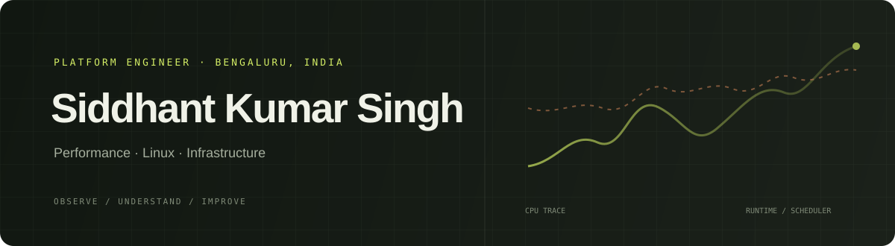

  

  <a href="https://www.siddhantkumarsingh.me">Portfolio</a> &nbsp;·&nbsp;
  <a href="https://www.linkedin.com/in/siddhant-kumar-singh-/">LinkedIn</a> &nbsp;·&nbsp;
  <a href="mailto:singhsiddhantkumar@gmail.com">Email</a>

---

### Current focus

I work on the parts of software you feel when they’re slow: **performance investigations, Linux, runtime profiling, and infrastructure**. I like following the data to the bottleneck, then making targeted fixes.

| At ClickPost | Previously at Refyne |
| --- | --- |
| eBPF analysis of on-CPU and off-CPU time, including Python GIL contention · JFR data extraction and processing · currently optimizing Nomad systems through a custom driver | Backend systems handling **100K daily users** and **600K monthly users** · video KYC · resilient asynchronous workflows |

### Selected projects

<table>
  <tr>
    <td width="33%" valign="top">
      <strong><a href="https://github.com/Geralt-Of-Rivia-Witcher/tbreakout">tbreakout ↗</a></strong>  
      A playable Breakout game in the terminal, installable on macOS and Linux.  
      GO &nbsp;·&nbsp; TCELL
    </td>
    <td width="33%" valign="top">
      <strong><a href="https://github.com/Geralt-Of-Rivia-Witcher/Pull-Mage">Pull Mage ↗</a></strong>  
      A GitHub PR companion for reviewing changes and asking questions with context.  
      NESTJS &nbsp;·&nbsp; GITHUB APPS &nbsp;·&nbsp; AI
    </td>
    <td width="33%" valign="top">
      <strong><a href="https://github.com/Geralt-Of-Rivia-Witcher/Gamopedia_Frontend">Gamopedia ↗</a></strong>  
      A video-game encyclopedia for exploring releases, creators, stores, and screenshots.  
      REACT &nbsp;·&nbsp; NODE.JS &nbsp;·&nbsp; RAWG
    </td>
  </tr>
</table>

<a href="https://github.com/Geralt-Of-Rivia-Witcher?tab=repositories">More repositories ↗</a>

### Toolbox

`Go` &nbsp; `Python` &nbsp; `TypeScript` &nbsp; `Linux` &nbsp; `eBPF` &nbsp; `JFR` &nbsp; `Nomad` &nbsp; `AWS` &nbsp; `NestJS` &nbsp; `Redis`

---

Curious about what happens underneath. &nbsp;·&nbsp; Bengaluru, India

